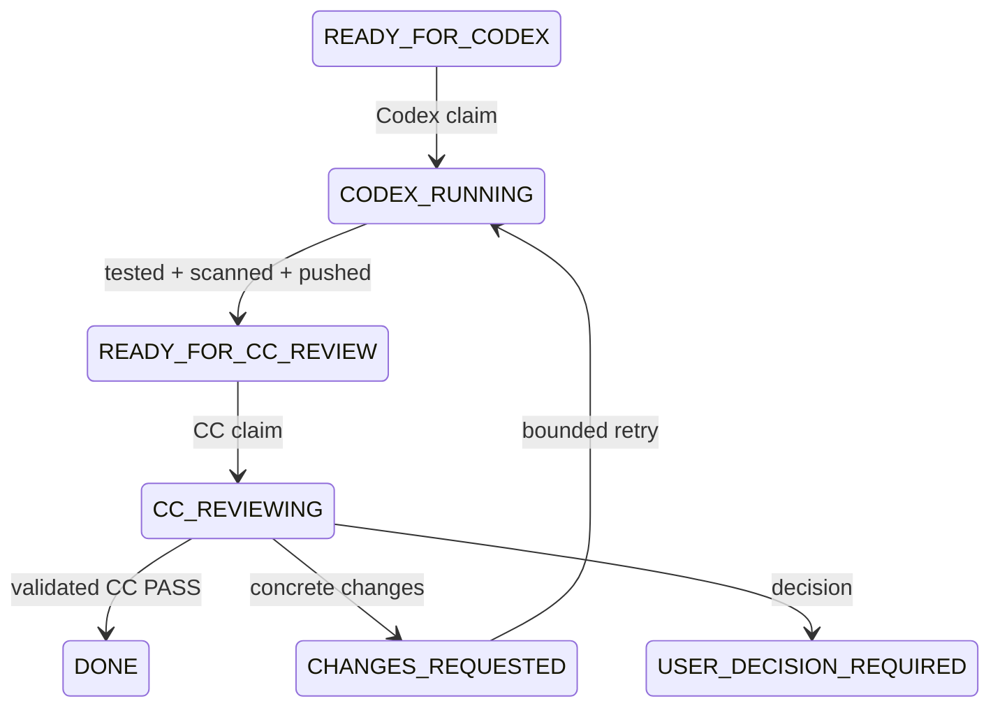

# GitHub-driven autonomous workflow — phase 1

This is a finite, manually started controller, not a daemon or self-hosted runner.
User decides product/topic/architecture/scope, credentials, destructive actions,
security exceptions and unresolved agent conflicts. Codex implements/researches/tests;
Claude Code independently reviews/verifies; GitHub owns all formal handoffs.

## Architecture and state machine



Mandatory safety/budget gates override ordinary edges: any active state may enter
USER_DECISION_REQUIRED. Fatal automation errors enter FAILED. These emergency
transitions belong to the controller. Codex cannot mark DONE, including by returning
the word PASS or by requesting another actor through Issue text.

Eight exact labels are installed by `python scripts/agent-orchestrator.py --setup-labels`.
A single Issue PATCH replaces all workflow labels together while retaining unrelated labels.
Persistent counters, evidence SHA, review and usage/duration audit live in
`automation/state.json` on `agent-state/issue-N` branches, not mutable task comments.
File SHA compare-and-swap protects ledger updates. Human-readable handoffs/reviews are
also posted to the Issue. State-branch commits are control metadata, not application releases.

GitHub cannot transactionally update a content blob and an Issue label in one request.
Any mismatch or partial write stops for reconciliation; it never triggers a blind retry.
Each new agent rechecks the ledger, labels, author/editor and pinned body digest.

## Locks and iteration limits

A repository-local exclusive `.git/agent-workflow.lock` protects this checkout. Atomic
GitHub ref creation claims `agent-locks/executor` and `agent-locks/issue-N` using a unique
marker commit. Only the holder of that exact SHA removes its lock refs. Marker commits
do not enter main history. All cooperating controllers use the same protocol.

There is no age/TTL-based lease stealing. A crashed/stale lock or running label stops
the next invocation. Owner must reconcile it; deleting another live owner's lease is unsafe.
The repository executor lock also prevents two different tasks from modifying one checkout.

Hard caps: 3 Codex attempts, 3 CC review rounds, at most 6 steps in one invocation.
Issue limits may lower these caps. Counters increment before a model call and survive
restarts. Third unsuccessful review/exhausted attempts enter USER_DECISION_REQUIRED.
Each agent has a pinned timeout (900 seconds by default, maximum 1800). Review input is
capped at 128 KiB (the complete necessary diff/evidence, not the repository or session history). No next Issue starts inside the current invocation after PASS.

## Owner-approved tasks and long prompts

1. Edit `tasks/READY/<TaskId>.md` in VS Code using the template.
2. Owner publishes it as an Issue with `gh issue create --body-file` and READY_FOR_CODEX.
3. In `automation/policy.json`, add a plan keyed by Task ID: exact issue_number,
   body_sha256 of the fetched GitHub body, codex_enabled/cc_enabled, allowed_write_paths,
   required_tests (argv arrays), sandbox_acknowledged and optional followups.
4. Review, commit and push the plan. The controller accepts no shell command or permission
   instruction from an arbitrary Issue/comment. A missing/changed plan is a User gate.

Example plan shape (numbers/hash are placeholders, not an enabled task):

```json
{
  "issue_number": 123,
  "body_sha256": "OWNER_REVIEWED_BODY_SHA256",
  "codex_enabled": true,
  "cc_enabled": true,
  "sandbox_acknowledged": true,
  "allowed_write_paths": ["src/example.py", "tests/test_example.py"],
  "required_tests": [["python", "-m", "unittest", "discover", "-s", "tests"]],
  "followups": {}
}
```

Only repository owner or explicitly trusted authors/editors qualify. PRs and comment
events are not task sources. Requirement changes invalidate the body pin. Current
phase allows AUTO-/TOOLING- prefixes; R01-R06 and other product domains are not authorized.
Scripts/controller/policy/AGENTS/CLAUDE/CI changes require User review and cannot be
published by an autonomous Codex plan. AUTO-001 itself is a manual implementation with
Codex execution disabled and independent CC review enabled.

The Task folders are editor-friendly source/mirrors, not a competing state database.
The controller reads the GitHub Issue. TUI is only for short questions and debugging.

## Verified headless interfaces

Local versions verified: Codex 0.164.0, Claude Code 2.1.311. No keyboard/TUI automation.

Codex uses `codex exec`, stdin requirements, workspace-write sandbox, approval never,
network disabled, ignored user config, JSON output schema and final-message artifact.
The controller, not the model, runs pinned tests, scopes changes, calls the existing
export/scan/finalize workflow and updates GitHub. Raw stdout events are never printed
or persisted; only actual numeric usage fields are retained. No auth-token extraction.

Claude uses `-p --output-format json --json-schema`, safe mode, restricted mode, no
tools, empty strict MCP config, no session persistence, and an isolated temporary cwd.
It receives only Issue/criteria, remote report at the published SHA, scoped diff and
test evidence. It cannot run Git/commands, edit files or explore the repository.
`--bare` is intentionally not used because this installed version requires API-key
auth for bare mode; existing native login is preserved. No unverified max-turns flag
is assumed. Timeout, input size, tool removal and controller round limits bound review.

Reviewer JSON must contain exactly result, summary, required_changes,
recommended_next_task and user_question. Invalid JSON, contradictory PASS, missing
questions or unapproved next scope stop for User. PASS alone is not trusted if the
reviewed commit, source or working tree changed. A CC report is committed/scanned/pushed
by the controller before the final state is published.

CC PASS -> DONE. CHANGES_REQUESTED -> same bounded task. A recommended next task creates
an Issue only when it exactly selects an owner-pinned followup template; no arbitrary
roadmap text is executable. The new Issue is queued READY_FOR_CODEX and needs its own
number-bound approved plan before a later manual invocation can execute it.

Official references: [Codex non-interactive mode](https://developers.openai.com/codex/noninteractive),
[Claude headless mode](https://code.claude.com/docs/en/headless),
[GitHub Git refs](https://docs.github.com/en/rest/git/refs).

## Dry run and manual run

```powershell
python scripts/agent-orchestrator.py --dry-run
python scripts/agent-orchestrator.py --issue 1 --dry-run
python scripts/agent-orchestrator.py --issue 1
.\scripts\run-codex-task.ps1 -IssueNumber 1 -Repository DevonForlan/ugreen-ai-nas-hackathon-2026 -TaskId AUTO-001 -DryRun
.\scripts\run-cc-review.ps1 -IssueNumber 1 -Repository DevonForlan/ugreen-ai-nas-hackathon-2026 -TaskId AUTO-001 -DryRun
```

Replace number/Task ID with the approved task. The PS runners invoke one shared
controller step; the default orchestrator reuses those same runner functions under
one lease for at most six steps. Dry-run performs GitHub reads only: issue, state,
intended agent/action/next state. No model, notification, counter, lock or write.

AUTO-001 completion stops at READY_FOR_CC_REVIEW. Do not launch its live reviewer
while implementing it. A later reviewer invocation consumes normal account usage.
Mocks validate the full loop without calling a paid/live model; this is not evidence
that real model reasoning or every account's auth behavior has been acceptance-tested.

## Safety gates and security boundary

Stop for product direction, competition topic, major architecture, scope expansion,
paid service, new credential, detected secret, destructive data operation, production,
force push, security uncertainty, repeated test failure or unresolved agent disagreement.
First controller-observed test failure also gates conservatively instead of retrying blindly.
Decision comments contain reason, question, options and recommendation; agents do not choose.

Owner-source checks, body pinning, protected paths and tool-less review mitigate prompt
injection. They are not an OS boundary against arbitrary hostile local programs.
Codex's native sandbox is required, and the owner must acknowledge its limitations in
each execution plan. Do not use this phase for untrusted code, credential-sensitive
work or unattended production operations. New security uncertainty is a User gate.
Required tests execute code on the host: approve their source and argv before enabling.

No credentials, complete environment dumps, auth caches, runtime JSONL or hidden reasoning
go into GitHub. Existing sanitization/secret scanning remains mandatory; unknown formats
still require human review. Model JSON is scanned before handoff. Sensitive environment
variables are not forwarded to models, pinned tests or the finalize subprocess; native
account login remains in the CLIs. Environment-only API credentials require a separate
User security decision rather than automatic forwarding. Snapshots also monitor ignored
runtime configuration and Git config, and recheck scope after tests. Nothing guesses subscription
quota from usage. Each attempted round records actor, task ID, iteration, duration and
safe actual numeric usage or UNKNOWN. Native account auth remains inside the CLIs.

## Notifications, stop procedure and troubleshooting

Existing native Windows notification/sound is reused for start, review outcome, User
gate and failure. UI failure falls back to terminal/GitHub and does not rerun a model.

- Ctrl+C stops the current child process tree, records the stop and does not auto-resume.
- During a running child, the controller checks GitHub state/source and local stop file
  at bounded ten-second communication intervals. A stop/change terminates the child tree.
  API delay can add latency; this is cooperative cancellation, not a hard real-time guarantee.
- Create `.git/AUTO_STOP.json` or set the Issue USER_DECISION_REQUIRED to request a stop.
  Never delete a live lock or change a running Issue back to READY to start a second agent.
- GitHub/partial-write errors record a local emergency stop with LOCAL ONLY — NOT SYNCED.
  Reconcile GitHub ledger/labels/branch and remaining work before removing that stop file.
- Stale locks: confirm no owner process remains, inspect exact marker SHA and pending Git
  work, then let User deliberately recover the owned metadata refs/local lock. No TTL guessing.
- FAILED / USER_DECISION_REQUIRED / running states block other live tasks, including an
  explicitly selected issue. Resolve/close the stopped Issue as User before queuing a fresh
  approved task; the ordinary state machine has no automatic User-gate bypass transition.
- Auth failure: stop and have User restore normal CLI login. Never print/read tokens.
- Dirty tree, changed evidence SHA, oversized packet, unauthorized source or controller-file
  changes: preserve local work and ask User. No reset --hard, force push or automatic rebase.
- If a blocked agent modified controller files, do not rerun those modified scripts.
  Recover/review them as User from the trusted published commit first. This phase does
  not turn arbitrary hostile code into a safe host workload.

## Tests

```powershell
python -m unittest discover -s tests -p 'test_agent_workflow.py' -v
python -m unittest discover -s tests -p 'test_*.py' -v
python scripts/agent-orchestrator.py --issue 1 --smoke-lock
```

The last command makes/relinquishes real metadata lock refs and attempts a second
acquisition, but never invokes an agent. Use only an authorized task. Unit tests mock
agents/GitHub: all legal/illegal transitions, max counters, handoff, PASS/changes/User/failed,
locking, malformed JSON, GitHub failure, notification fallback, source rejection and
scope/body changes. No permanent Actions/self-hosted runner is installed in phase 1.
# AUTO-002 transcript transport; AUTO-001 remains paused

Headless runner instrumentation now captures/sanitizes final visible output only
after process exit, writes global/project history and a per-run ledger, and verifies
transcript publication before handoff/acceptance. See the
[Agent transcript-sync guide](AGENT_TRANSCRIPT_SYNC_GUIDE.md) for exact guarantees,
interactive limitations and recovery. Capture failure prevents a successful handoff.
This does not approve AUTO-001's trust root or host-test boundary. Keep
`codex_enabled=false`; do not run the autonomous loop while its User decisions remain open.
The existing mocked workflow tests alone are not proof of live transcript transport;
AUTO-002 adds separate capture/publication tests using synthetic events and child processes.

